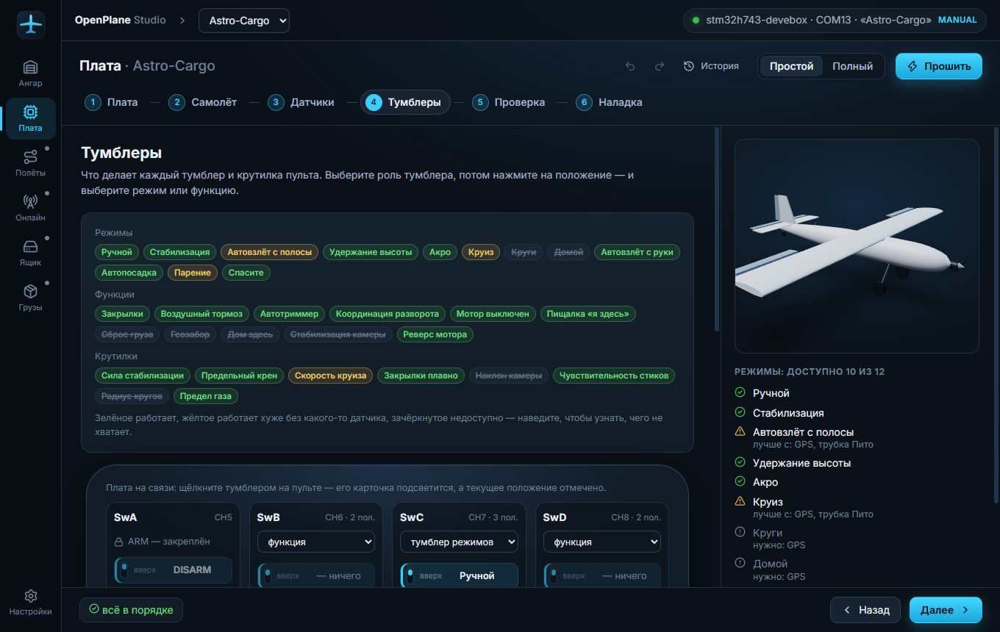
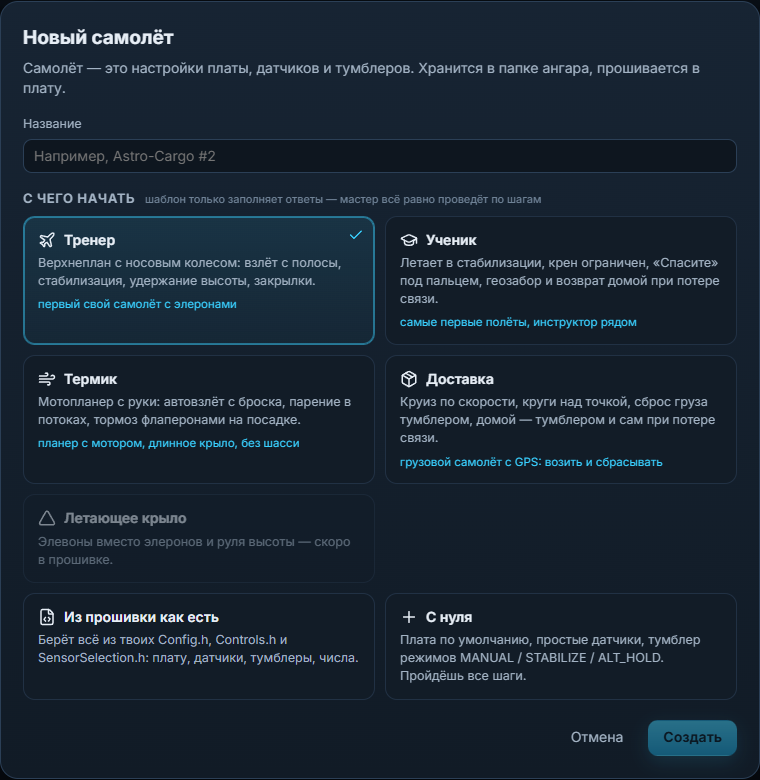
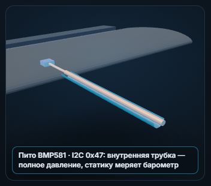
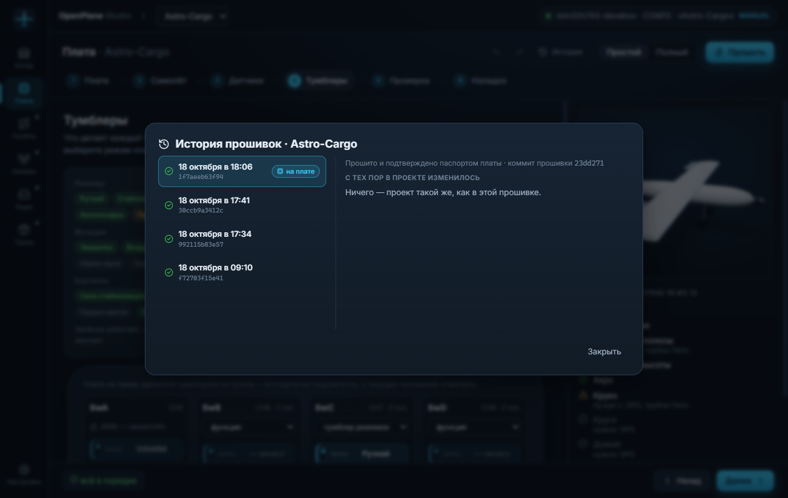
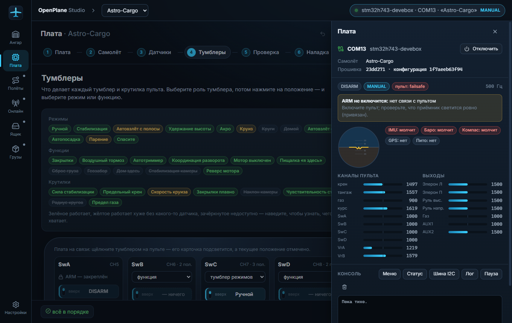
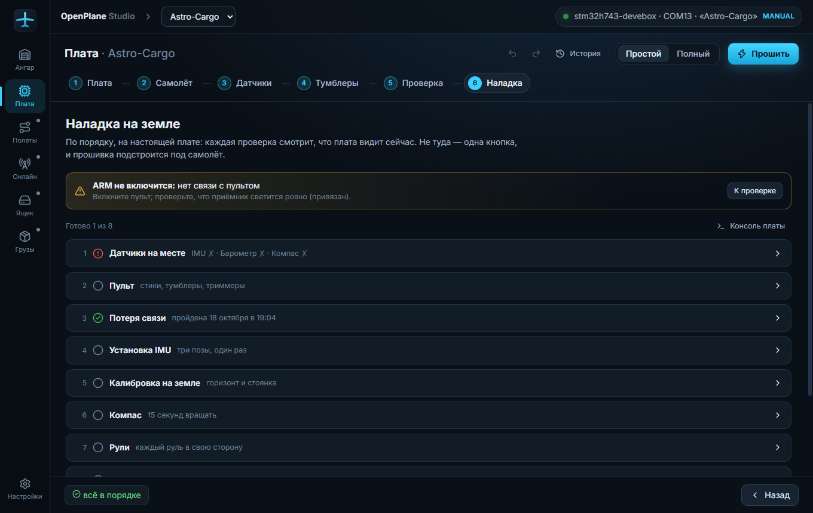

# OpenPlane Studio

Приложение для самолёта на прошивке [OpenPlane](https://github.com/damir-lebedev/OpenPlaneProject):
настроить плату по шагам, собрать прошивку под свой самолёт, прошить её одной
кнопкой и наладить на земле — по живым данным с платы. Разделы «Полёты»,
«Онлайн», «Чёрный ящик» и «Грузы» — пока заглушки «Скоро». План и список дел —
[PLAN.md](PLAN.md).

**Tauri 2** (Rust) + React + TypeScript + three.js. Windows, установщик ~1,5 МБ.
Работает без интернета.



## Что умеет

**Ангар.** Самолёт — папка `Документы/OpenPlane/Hangar/<id>/`. Новый — из
прошивки как есть, с нуля или по шаблону: «Тренер», «Ученик» (крен
ограничен, «Спасите» под пальцем, геозабор), «Термик» (мотопланер с руки,
парение), «Доставка» (круиз, сброс груза, домой).



**Мастер по шагам.** Плата → самолёт → датчики → (пульт) → тумблеры →
(безопасность, система) → проверка → наладка. Шаги открываются по порядку.
Простой режим — главное, остальное под «Дополнительно»; полный — каждый
параметр и таблица «Все параметры». У чисел — единицы и «обычно a…b» из
меток `@range` прошивки; у режима — его числа рядом с ним.

**Что чему нужно.** Режим без датчика серый: «Для работы режима RTH нужны
датчики: GPS» и кнопка «Добавить». Правила — из меток `@needs` в прошивке,
приложение ничего о ней не выдумывает.

**Пины.** Выбор из списка тех, что умеют нужное: «PA3 — TIM2_CH4» для серво,
UART и I2C парами на одном экземпляре, занятое на плате (USB, µSD, флеш) —
серым с причиной. Для STM32 — из варианта STM32duino, по которому собирается
прошивка (`tools/gen_pins.py`); для ESP32 — по даташитам.

**Готовый полётник.** Кроме самодельных плат — Matek H743-WING V3: IMU и
барометр на плате выбираются сами и не меняются, пины распаянного — под замком,
компас и трубка Пито — на внешнем разъёме I2C. После прошивки приложение
попросит показать, как плата стоит в самолёте (три позы), — до этого ARM со
стабилизацией не включится. На настоящей плате ещё не проверяли.

**3D-самолёт.** Деталь, о которой речь, подсвечена, камера наезжает на неё;
чего нет — растворяется, а при наведении видно, где оно будет. Трубка Пито —
в разрезе, с датчиком и адресом на шине. Рули ходят от стиков настоящего
пульта, самолёт наклоняется по IMU платы. Самолёт — абстракция: не копия
конкретной модели, но правдив в том, что настраивается.



**Пульт на экране.** FS-i6: на какое положение какого тумблера какой режим,
функция или крутилка. С платой на связи щёлкнутый тумблер подсвечивается.
Приёмник — iBUS (FlySky), SBUS (FrSky, Futaba, RadioMaster…) или CRSF
(ExpressLRS, TBS Crossfire): выбор одной кнопкой, рядом — как подключить к
пинам вашей платы; если прошивка на плате ждёт другой приёмник — приложение
скажет.

**Прошивка одной кнопкой.** Конфигурация пишется в копию исходников
(`tools/opconfig.py apply`), PlatformIO собирает, плата сама уходит в
загрузчик (клавиша `D` через открытую связь), заливка — dfu-util или esptool,
в конце плата отвечает паспортом — хэш конфигурации сверяется. Драйвер DFU и
PlatformIO ставятся одной кнопкой. После прошивки — проверка, что калибровки
на месте. Ошибки — одной понятной фразой и с действием.

**История.** Снимок самолёта на каждую прошивку: что изменилось с тех пор,
вернуть как было одной кнопкой; Ctrl+Z / Ctrl+Y для правок. Перед прошивкой —
«что изменится на плате», а если обновилась сама прошивка — что это значит для
самолёта (новые режимы, сменившиеся значения по умолчанию — «оставить как
было»). Прошивка — из своей папки или с GitHub: последний выпуск, выбранный
или main.



**Связь с платой.** Порт держит приложение — свой монитор порта не нужен.
Плашка в шапке открывает панель: что плата видит прямо сейчас (режим, пульт,
почему ARM не включится, датчики, каналы, выходы) и консоль.



**Наладка на земле.** По порядку, на настоящей плате: датчики против проекта
(опрос шины с адресами), пульт (стики в свою сторону, тумблер пришёл не на
тот канал — прошивка переназначается, триммеры), потеря связи (с рецептом
failsafe для FS-i6), установка IMU тремя позами, калибровка на земле, компас,
рули («пошёл так?» — «нет» переворачивает ровно этот руль), мотор (винт
снят!), режим стенда с плашкой, пока не снят.



**Русский и английский.** Язык — в «Настройках»; при первом запуске — по
языку и часовому поясу системы. Переведено всё, что видно, включая тексты
прошивки: описания параметров из `Config.h`, платы, датчики.

## Установка

Интернет для установки не нужен: всё, чем приложение собирает и прошивает
платы на STM32 (DevEBox, WeAct, Matek H743), — внутри установщика: PlatformIO
со своей копией Python (системный Python не трогается), исходники прошивки,
компилятор, ядро STM32 и библиотеки прошивки. Интернет понадобится только для
плат на ESP32 (их инструменты скачаются при первой сборке) и чтобы обновить
прошивку с GitHub.

**Windows 10/11** — `OpenPlane Studio_…_x64-setup.exe`. На странице «Всё для
сборки и прошивки» две галочки: «Установить всё необходимое» (PlatformIO,
исходники, драйвер режима прошивки STM32 — одно окно UAC, плата не нужна) и
«Инструменты сборки STM32» (около 2 ГБ на диске). Установщик не подписан
платным сертификатом: SmartScreen — «Подробнее» → «Выполнить в любом случае».

**macOS 11+** — `OpenPlane Studio_…_aarch64.dmg` (Apple M1…M4) или `…_x64.dmg`
(Intel): перетащить в «Программы». Приложение не заверено в Apple: при первом
запуске — «Системные настройки» → «Конфиденциальность и безопасность» → «Всё
равно открыть» (до macOS 14 — правой кнопкой → «Открыть»). Затем окно
«Подготовка компьютера» ставит то же самое из приложения (драйвер на macOS не
нужен).

Что-то не поставилось — «Настройки» → «Подготовка компьютера». Подробно для
пользователя — `УСТАНОВКА.txt` в архиве с установщиками.

Собирают установщики workflow «Установщики» (`.github/workflows`, все три) или
локально:

```bash
python tools/offline_bundle.py --firmware ../plane --uv uv   # всё для работы без интернета
npm run tauri build                                         # установщик под эту систему
```

`offline_bundle.py` кладёт в `src-tauri/resources/offline` Python 3.12,
колёса PlatformIO, исходники прошивки, платформу ststm32 с пакетами (без SVD
отладчика и драйверов неиспользуемых серий STM32) и библиотеки прошивки; без
этой папки установщик тоже собирается, но ставит всё из интернета.
Подготовка без окна (так её вызывает установщик):
`openplane-studio --setup [--tools] [--driver] [--lang en]`.

## Как запустить

Нужно один раз: [Node.js](https://nodejs.org) 22+, [Rust](https://rustup.rs) и
Visual Studio Build Tools (C++). PlatformIO и исходники прошивки приложение
поставит и скачает само («Настройки»), или возьмёт папку `plane` рядом.

```bash
npm install
npm run app            # окно приложения в режиме разработки
npm test               # логика и интерфейс на фейковой плате (vitest)
npm run tauri build    # установщик: Windows — NSIS, macOS — .dmg (src-tauri/target/release/bundle)
```

Описание прошивки для тестов (`src/core/__fixtures__/manifest.json`) и
таблицы пинов STM32 обновляются из исходников прошивки и STM32duino:

```bash
npm run fixture
python tools/gen_pins.py
```

Все ли строки переведены — и приложения, и прошивки (`../plane`):

```bash
python tools/i18n_check.py             # сводка; --missing — список непереведённых
```

Перед выпуском — ручная проверка на железе: [docs/CHECKLIST.md](docs/CHECKLIST.md).

## Как устроено

| Где | Что |
|---|---|
| `src/core/` | без интерфейса: описание прошивки, самолёт, правила, конфигурация, живые данные, пины, история, шаблоны — с тестами |
| `src/components/` | интерфейс: ангар, мастер, пульт, 3D (`plane3d/`), панель платы, наладка (`board/setup/`); тесты интерфейса — `__tests__/` |
| `src/flash.ts` | кнопка «Прошить»: сборка → плата в загрузчик → заливка → паспорт → калибровки |
| `src/i18n.ts`, `src/locales/` | перевод: ключ — русская строка (как в gettext); `en.json` — приложение, `en.firmware.json` — тексты прошивки |
| `src-tauri/src/` | Rust: USB и COM-порты, связь с платой (`link.rs`), PlatformIO, драйвер DFU, файлы ангара, GitHub |
| прошивка `tools/opconfig.py` | описание прошивки и запись конфигурации — в репозитории прошивки, чтобы не разъезжаться с ней |

Связь с платой — строки консоли прошивки: команды ПК начинаются с байта STX
(`id`, `live`, `scan`, `act X`, `bb …`), ответы — строки `@id {...}`,
`@live {...}`, `@scan {...}` (описание — в справочнике телеметрии прошивки).

## Лицензия

[OpenPlane License](LICENSE) — та же, что у прошивки: MIT с обязательным
указанием автора, без военного применения и без намеренного вреда людям и
имуществу.
